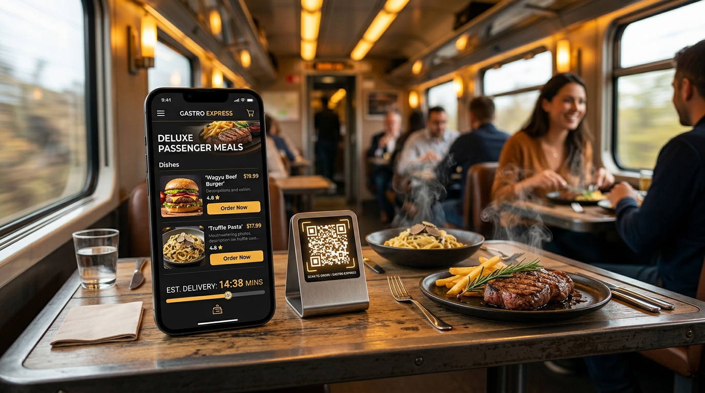
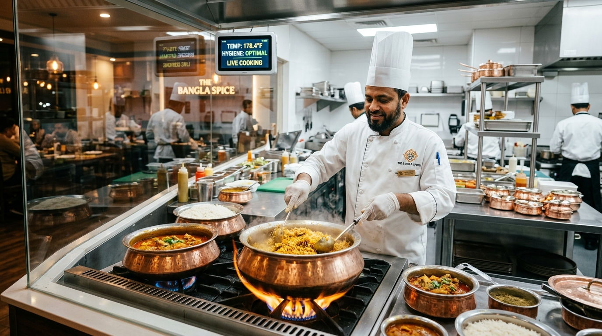
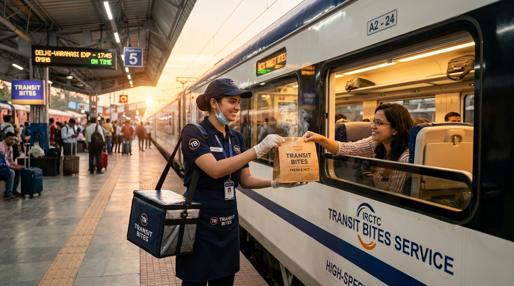

# 🍽️ হোটেল আল শেখ ফরিদ (Hotel Al Sheikh Farid)

<p align="center">
  
</p>

<p align="center">
  <strong>"রেলওয়ে স্টেশন এলাকার সেরা ঘরোয়া ও তাজা খাবারের বিশ্বস্ত ঠিকানা"</strong><br>
  <em>ঐতিহ্যবাহী কাচ্চি বিরিয়ানি • খাঁটি সরিষার তেলে রান্না • গরম জিলাপি ও দেশি মিষ্টান্ন</em>
</p>

<p align="center">
  <strong>প্রোপাইটার:</strong> মোহাম্মদ আব্দুল বারিক শেখ &nbsp;|&nbsp; 
  <strong>ঠিকানা:</strong> রেলওয়ে স্টেশন মেইন গেট সংলগ্ন, স্টেশন রোড<br>
  <strong>যোগাযোগ:</strong> 📞 ০১৭১১-৫৩৩৯৮৩৬ / ০১৭৬১-৮৬৯৯২১ &nbsp;|&nbsp; ✉️ fs2217732@gmail.com
</p>

---

## 📖 প্রকল্প পরিচিতি (Project Overview)

**হোটেল আল শেখ ফরিদ** একটি সর্বাধুনিক, পূর্ণাঙ্গ এবং ইন্টারেক্টিভ ওয়েব-ভিত্তিক অনলাইন রেস্তোরাঁ ও ফুড অর্ডারিং প্ল্যাটফর্ম। রেলওয়ে স্টেশন এলাকায় আগত ট্রেনের যাত্রী, দর্শনার্থী এবং স্থানীয় পরিবারবর্গের জন্য ঘরে বসেই তাজা ও স্বাস্থ্যকর দেশীয় খাবার অর্ডার, টেবিল রিজার্ভেশন, বিকাশ/নগদ পেমেন্ট এবং তাৎক্ষণিক গ্রাহক সেবা নিশ্চিত করার লক্ষ্যে এটি নির্মিত হয়েছে।

<p align="center">
  
</p>

অ্যাপ্লিকেশনটিতে রয়েছে কৃত্রিম বুদ্ধিমত্তা চালিত স্মার্ট মেনু অ্যাসিস্ট্যান্ট, বাংলা ভয়েস কমান্ড, লাইভ অডিও/ভিডিও কল সাপোর্ট, রিয়েল-টাইম কিচেন ট্র্যাকিং, কিউআর কোড স্ক্যানার ও মাল্টি-প্ল্যাটফর্ম মিডিয়া শেয়ারিং সুবিধা।

---

## ✨ প্রধান বৈশিষ্ট্যসমূহ (Key Features)

### 🥘 ১. ডিজিটাল ফুড মেনু ও কাস্টম পরিমাপ (Live Dynamic Menu)
* **শ্রেণিভিত্তিক ফিল্টারিং:** সকালের নাস্তা, দুপুরের খাবার, রাতের ডিনার, মিষ্টি ও স্ন্যাক্স, চা ও বেভারেজ।
* **বহুস্তরীয় খাদ্য পরিমাপ (Portion Options):** ২৫০ গ্রাম, ৫০০ গ্রাম, ১ কেজি, ফুল প্লেট, হাফ প্লেট ও ফ্যামিলি প্যাক।
* **তাজা ও হট ব্যাজ:** হট ফ্রাইড জিলাপি, খাঁটি সরিষার তেলে রান্না এবং দৈনিক স্পেশাল আইটেম ট্র্যাকিং।
* **লাইভ সার্চ ও ডায়েট ফিল্টার:** নিরামিষ, মাছ, মাংস ও ভর্তার দ্রুত অনুসন্ধান।

---

### 🍳 ২. লাইভ কিচেন ও হাইজিন মনিটরিং (Live Kitchen & Hygiene Transparency)

<p align="center">
  
</p>

* **স্বচ্ছ রান্না ও হাইজিন লাইভ ফিড:** গ্রাহকরা লাইভ কিচেন অডিও-ভিডিও স্ট্রিমের মাধ্যমে খাবার তৈরির পরিবেশ ও পরিচ্ছন্নতা সরাসরি দেখতে পারেন।
* **রিয়েল-টাইম কুকিং টেম্পারেচার (74°C+):** জীবাণুমুক্ত ও ফুটন্ত গরম পরিবেশন নিশ্চিতকরণ।

---

### 🍯 ৩. দেশি মিষ্টান্ন ও স্পেশাল আইটেম (Authentic Bengali Sweets & Specials)

<p align="center">
  
</p>

* **গরম মচমচে জিলাপি:** প্রতিদিন সকাল ও বিকেলে খাঁটি তেলে ভাজা গরম রসে টইটম্বুর জিলাপি।
* **রসগোল্লা, চমচম ও মিষ্টি দই:** ঐতিহ্যবাহী মাটির হাঁড়ির খাঁটি মিষ্টি দই ও রসালো ডেজার্ট।

---

### 🛒 ৪. স্মার্ট কার্ট, রি-অর্ডার ও ট্রেন ডেলিভারি (Cart & Train Delivery)

<p align="center">
  
</p>

* **এক-ক্লিকে রি-অর্ডার (One-Click Re-order):** গ্রাহক তার অ্যাকাউন্টে অতীতের যেকোনো অর্ডারের সমস্ত পদ সরাসরি এক ক্লিকে কার্টে ফিরিয়ে এনে দ্রুত চেকআউট করতে পারেন।
* **ট্রেন প্ল্যাটফর্ম ও ট্রানজিট ডেলিভারি ট্র্যাকিং:** ট্রেন প্ল্যাটফর্ম, বগি নম্বর ও সিট নম্বরে সরাসরি এক্সপ্রেস ডেলিভারির সুবিধা (২-৫ মিনিটের দ্রুত হ্যান্ডওভার)।

### 🍽️ ৫. টেবিল ও সিট রিজার্ভেশন (Table & Seat Booking)
* **বিভিন্ন ক্যাটাগরির আসন ব্যবস্থা:**
  * 🚂 ট্রেন ও স্টেশন প্ল্যাটফর্ম ভিউ টেবিল (সবচেয়ে জনপ্রিয়)
  * ❄️ ভিআইপি শীতাতপ নিয়ন্ত্রিত (VIP AC) ফ্যামিলি কেবিন
  * 👨‍👩‍👧‍👦 ঐতিহ্যবাহী পর্দাযুক্ত ফ্যামিলি কেবিন
  * 🌿 রুফটপ ওপেন এয়ার গার্ডেন ভিউ
  * 🍽️ মেইন ডাইনিং হল
* **সময়সূচি ও ক্যালেন্ডার:** আজ বা যেকোনো ভবিষ্যৎ তারিখের ব্রেকফাস্ট, লাঞ্চ, ইভনিং স্ন্যাক্স বা ডিনার স্লট বুকিং।

### 📊 ৬. ব্যক্তিগত ব্যয় ও অর্ডারের ট্রেন্ডস চার্ট (Analytics & Visual Trends)
* **Recharts দ্বারা চালিত ভিজ্যুয়াল রিপোর্ট:** ব্যবহারকারীর অ্যাকাউন্টে মাসিক মোট খরচের হিসাব (৳) এবং অর্ডার সংখ্যার গ্রাফ।
* **লাইফটাইম মেট্রিক্স:** মোট খরচ, মোট সম্পন্নকৃত অর্ডার এবং গড় অর্ডার সাইজের বিশ্লেষণ।

### 💳 ৭. আধুনিক পেমেন্ট গেটওয়ে (bKash / Nagad / Rocket / COD)
* **বিকাশ, নগদ ও রকেট পার্সোনাল পেমেন্ট:** পেমেন্ট নম্বর কপি, ট্রানজ্যাকশন আইডি (TrxID) এন্ট্রি ও ইনস্ট্যান্ট যাচাইকরণ।
* **ক্যাশ অন ডেলিভারি (Cash on Delivery):** খাবার হাতে পেয়ে নগদে মূল্য পরিশোধের সুযোগ।

### 📲 ৮. কিউআর কোড স্ক্যানার ও সোশ্যাল মিডিয়া শেয়ার (PWA App & QR Share)
* **ক্যামেরা দিয়ে ইনস্ট্যান্ট স্ক্যান:** যেকোনো মোবাইলের ক্যামেরা দিয়ে স্ক্যান করলেই তাৎক্ষণিক অ্যাপ চালু ও ইনস্টল।
* **সোশ্যাল মিডিয়া শেয়ারিং:** WhatsApp, Facebook, Messenger, Telegram, X, SMS এবং Email-এ এক ক্লিকে অ্যাপের লিংক শেয়ার।
* **টেবিল স্ট্যান্ড ফ্লায়ার প্রিন্ট:** ডাইনিং টেবিল ও ক্যাশ কাউন্টারে প্রদর্শনের জন্য রেডি-টু-প্রিন্ট কিউআর পোস্টার।

### 🎙️ ৯. বাংলা ও ইংরেজি ভয়েস কমান্ড (Bangla Voice Assistant)
* কৃত্রিম ভয়েস রিকগনিশন দ্বারা মুখে বলেই কার্ট খোলা, মেনু দেখা, টেবিল বুকিং করা, কল লাগানো কিংবা অর্ডার সম্পন্ন করার সুবিধা।

### 🤖 ১০. জেমিনি এআই ফুড কনসালট্যান্ট (Gemini AI Kitchen Consultant)
* Google Gemini API চালিত এআই শেফ থেকে ক্যালোরি, ডায়েট পরামর্শ, ট্রেনের যাত্রাবিরতির দ্রুত খাদ্য তালিকা এবং রন্ধনপ্রণালী জানার ব্যবস্থা।

### 📄 ১১. ডিজিটাল মেমো ও PDF রসিদ (PDF Receipts & Email Invoicing)
* প্রতিটি অর্ডারের জন্য স্বয়ংক্রিয় জেনারেটেড ডিজিটাল ইনভয়েস ও মেমো ডাউনলোড।
* গুগল সাইন-ইন করা থাকলে সরাসরি গ্রাহকের জিমেইলে অফিশিয়াল ইনভয়েস প্রেরণের ব্যবস্থা।

### 🛡️ ১২. অ্যাডমিন ড্যাশবোর্ড ও কিচেন কন্ট্রোল (Admin & POS Dashboard)

<p align="center">
  
</p>

* **রিয়েল-টাইম অর্ডার ম্যানেজমেন্ট:** Pending, Cooking, Out for Delivery ও Delivered স্ট্যাটাস ট্র্যাকিং।
* **খাবারের দাম ও স্টক নিয়ন্ত্রণ:** রেস্তোরাঁর খাবারের মূল্য, স্টক ও স্টপ-অর্ডার তাৎক্ষণিক নিয়ন্ত্রণ।
* **হোটেলের তথ্য, দৈনিক স্পেশাল ও কুপন:** প্রোমো কোড ও অফার ম্যানেজমেন্ট।

---

## 🌐 গ্লোবাল SaaS ও হোয়াইট-লেবেল সমাধান (White-Label Food-Tech SaaS)

এই আর্কিটেকচারটি যেকোনো আন্তর্জাতিক রেস্তোরাঁ ও হাইওয়ে/ট্রানজিট ফুড চেইনের জন্য একটি সম্পূর্ণ **Zero-Commission Turnkey SaaS Solution**:

* ⚡ **হাইপার-লোকাল ট্রানজিট ইঞ্জিন:** ট্রেন, বাস টার্মিনাল বা এয়ারপোর্ট গেট কেন্দ্রিক ৩-১০ মিনিটের দ্রুততম ডেলিভারি হ্যান্ডঅফ।
* 🎥 **লাইভ হাইজিন ভিডিও স্ট্রিমিং:** কিচেন ট্রান্সপারেন্সির মাধ্যমে আন্তর্জাতিক গ্রাহকদের শতভাগ আস্থার নিশ্চয়তা।
* 🤖 **এআই শেফ ও মাল্টি-ল্যাঙ্গুয়েজ ভয়েস:** বহুভাষিক ভয়েস কমান্ড এবং ডায়নামিক নিউট্রিশন অ্যাসিস্ট্যান্ট।
* 💳 **জিরো-কমিশন ডিরেক্ট ক্যাশফ্লো:** থার্ড-পার্টি কমিশন ছাড়া সরাসরি মালিকের মার্চেন্ট অ্যাকাউন্টে শতভাগ পেমেন্ট।

---

## 🛠️ প্রযুক্তিগত সমাহার (Tech Stack)

| প্রযুক্তি (Technology) | বিবরণ (Description) |
| :--- | :--- |
| **Frontend Framework** | React 19 (TypeScript, Hooks & Functional Components) |
| **Styling & Design** | Tailwind CSS v4 (উচ্চমানের কনট্রাস্ট ও আধুনিক রেসপনসিভ ইউআই) |
| **Build Tool** | Vite 6 |
| **Database & Auth** | Firebase Firestore & Firebase Google Authentication |
| **Charts & Analytics** | Recharts & D3 |
| **AI Integration** | Google Gen AI SDK (`@google/genai` - Gemini 2.5 Flash) |
| **Icons & Media** | Lucide React |
| **PDF Generation** | jsPDF & html2canvas |
| **Animation & Effects** | Motion (`motion/react`) & Canvas Confetti |

---

## 📁 প্রজেক্টের ফাইল ও ডিরেক্টরি কাঠামো (Project Structure)

```text
hotel-al-sheikh-farid/
├── public/                     # স্ট্যাটিক অ্যাসেটস ও আইকন
├── src/
│   ├── components/             # রি-ইউজেবল ইউআই কম্পোনেন্টস
│   │   ├── Header.tsx          # নেভিগেশন ও যোগাযোগ হেডার
│   │   ├── Banner.tsx          # রেস্তোরাঁর মূল ব্যানার ও কুইক অ্যাকশন
│   │   ├── FoodCard.tsx        # প্রতিটি খাবারের কার্ড ও পোরশন অপশন
│   │   ├── CartDrawer.tsx      # শপিং কার্ট ও পেমেন্ট চেকআউট
│   │   ├── TableBookingModal.tsx # টেবিল ও সিট রিজার্ভেশন মডাল
│   │   ├── UserAccountModal.tsx  # অ্যাকাউন্ট, অর্ডার হিস্ট্রি, ট্রেন্ডস চার্ট ও রি-অর্ডার
│   │   ├── AdminDashboard.tsx  # হোটেল ম্যানেজমেন্ট ও POS ড্যাশবোর্ড
│   │   ├── AiAssistantModal.tsx # জেমিনি এআই ফুড অ্যাসিস্ট্যান্ট
│   │   ├── LiveCallModal.tsx   # লাইভ অডিও/ভিডিও কল সাপোর্ট
│   │   ├── VoiceCommandListener.tsx # বাংলা ভয়েস রিকগনিশন
│   │   ├── TodaysSpecialBanner.tsx # দৈনিক স্পেশাল ডিশ
│   │   └── ReviewsModal.tsx    # গ্রাহক রিভিউ ও রেটিং
│   ├── data/
│   │   └── initialData.ts      # হোটেলের তথ্য, মেনু আইটেম ও প্রাথমিক ডাটাবেজ
│   ├── services/
│   │   ├── firebase.ts         # ফায়ারবেস ইনিশিয়ালাইজেশন ও ফায়ারস্টোর সিঙ্ক
│   │   ├── gemini.ts           # জেমিনি এআই এপিআই সংযোগ
│   │   └── soundNotificationService.ts # নোটিফিকেশন অডিও সিন্থেসাইজার
│   ├── utils/
│   │   ├── pdfGenerator.ts     # অর্ডার মেমো ও পিডিএফ জেনারেটর
│   │   └── whatsappHelper.ts   # সরাসরি হোয়াটসঅ্যাপ অর্ডার ফরম্যাটিং
│   ├── types.ts                # টাইপস্ক্রিপ্ট টাইপ ডেফিনিশন
│   ├── App.tsx                 # প্রধান অ্যাপ্লিকেশন রুট
│   └── main.tsx                # এন্ট্রি পয়েন্ট
├── package.json                # প্রজেক্ট ডিপেনডেন্সি ও স্ক্রিপ্টস
├── vite.config.ts              # ভাইট কনফিগারেশন
└── README.md                   # প্রজেক্ট ডকুমেন্টেশন
```

---

## 🚀 ইনস্টলেশন ও চালনা পদ্ধতি (Getting Started)

### ১. রিপোজিটরি ক্লোন করুন (Clone Repository):
```bash
git clone <repository-url>
cd hotel-al-sheikh-farid
```

### ২. ডিপেনডেন্সি ইনস্টল করুন (Install Dependencies):
```bash
npm install
```

### ৩. ডেভেলপমেন্ট সার্ভার চালু করুন (Start Dev Server):
```bash
npm run dev
```
ব্রাউজারে চালু করতে ওপেন করুন: `http://localhost:3000`

### ৪. প্রোডাকশন বিল্ড তৈরি করুন (Production Build):
```bash
npm run build
```

---

## 📍 হোটেল ঠিকানা ও সেবা সময়সূচি (Location & Hours)

* **হোটেল:** হোটেল আল শেখ ফরিদ
* **স্বত্বাধিকারী:** মোহাম্মদ আব্দুল বারিক শেখ
* **অবস্থান:** রেলওয়ে স্টেশন মেইন গেট সংলগ্ন, স্টেশন রোড
* **সময়সূচি:** প্রতিদিন সকাল ০৬:০০ টা থেকে রাত ১২:০০ টা পর্যন্ত
* **পেমেন্ট নম্বর:** `01761869921` (বিকাশ / নগদ / রকেট)

---

## 📜 কপিরাইট ও লাইসেন্স (License)

© ২০২৬ **হোটেল আল শেখ ফরিদ** (Hotel Al Sheikh Farid)। সর্বস্বত্ব সংরক্ষিত।
প্রোপাইটার: মো: আব্দুল বারিক শেখ।
